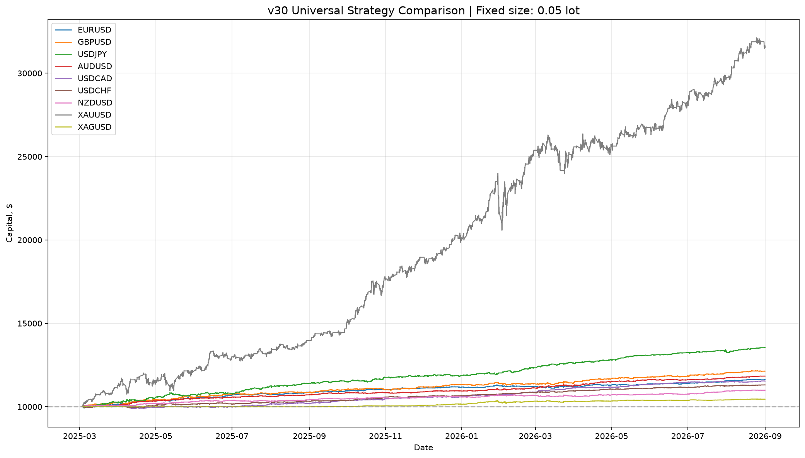
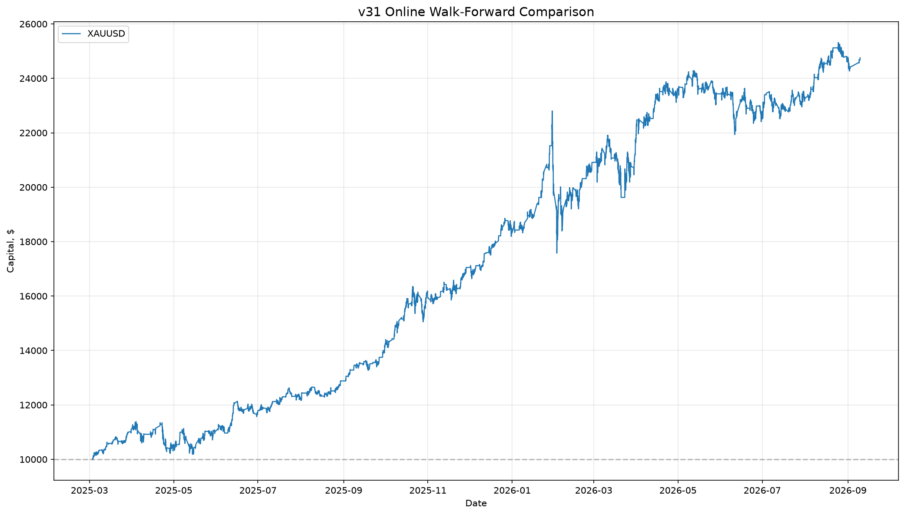
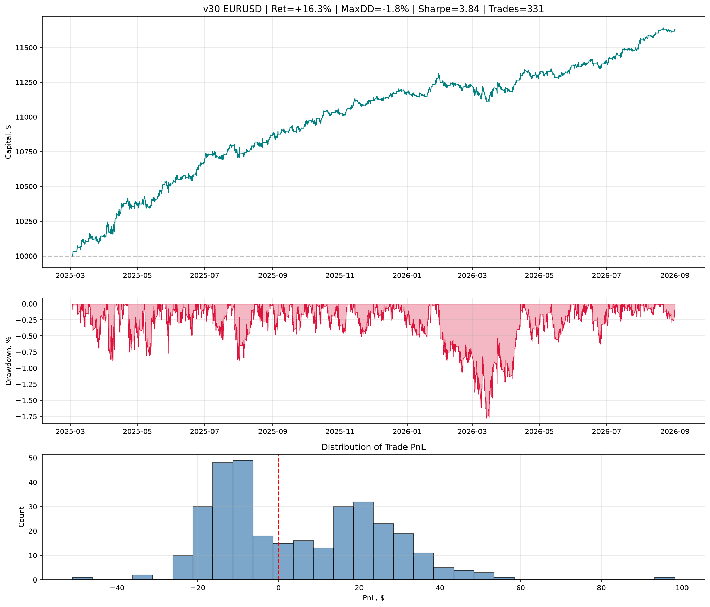
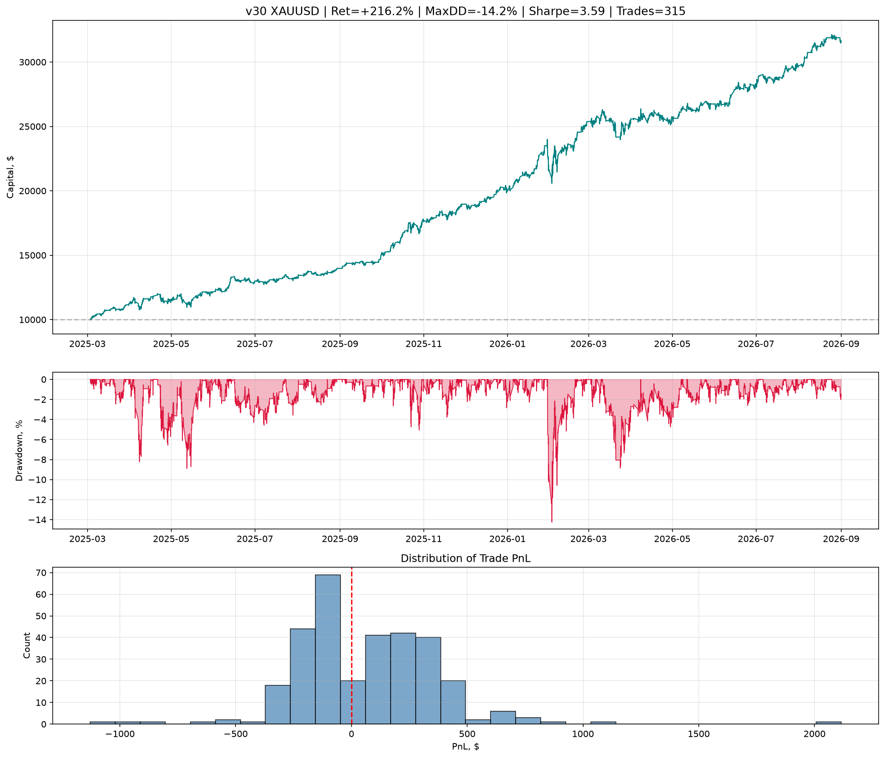
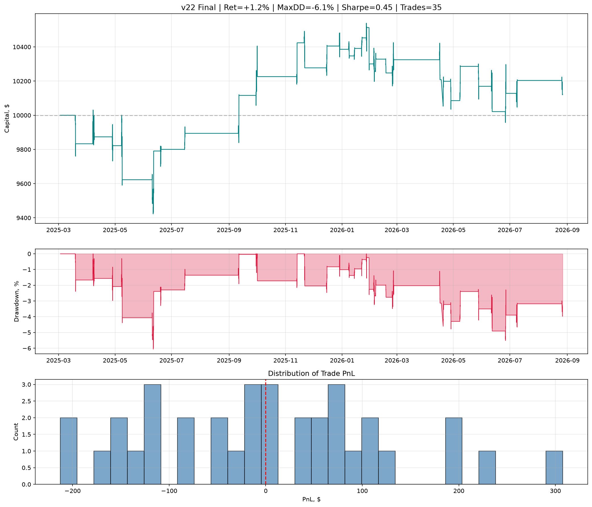
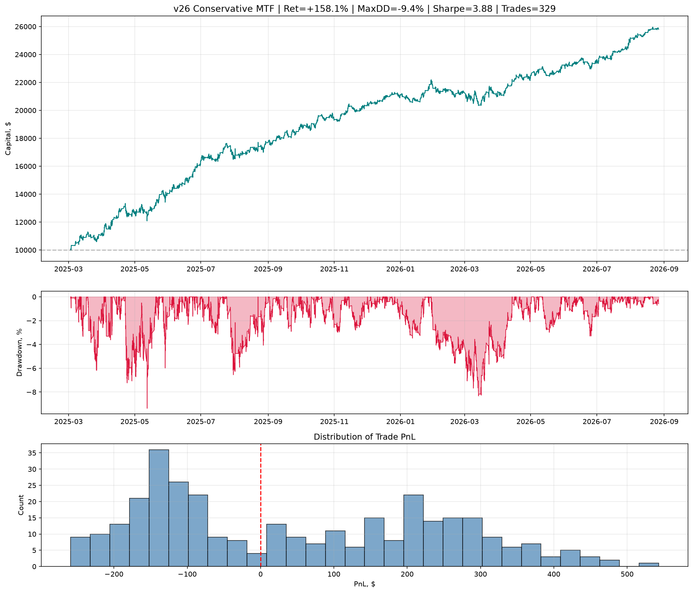
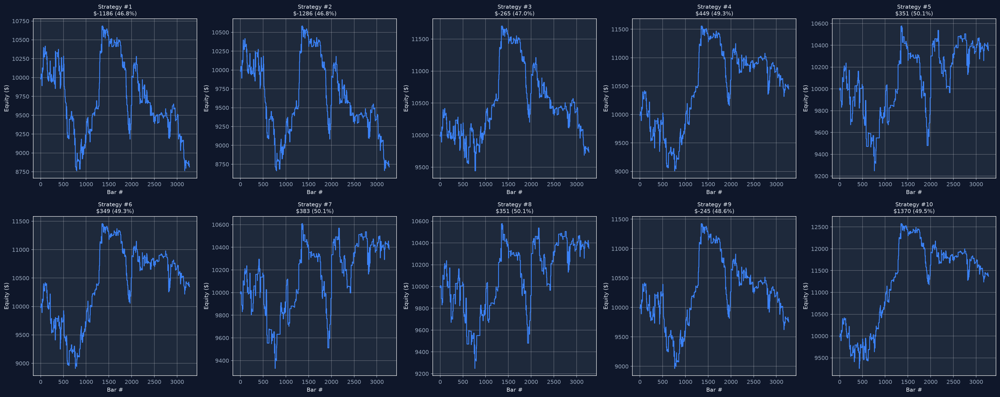
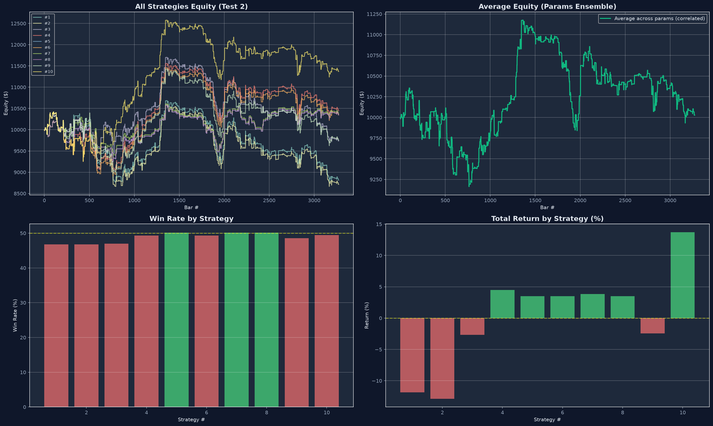

# Cross-MA + LightGBM

Торговая система на форексе: сигналы пересечения цены со скользящими средними (Cross-MA) отбирает градиентный бустинг LightGBM, прогон идёт walk-forward на истории H1/H4/D1. Много версий стратегии (v7 → v31), девять инструментов, графики эквити и дашборд.

## Описание системы на словах

### 1. Признаки: что видит модель

На каждом баре H1 строится около 35 каузальных признаков (только прошлое):

- **Тренд и Cross-MA** — расстояние цены до SMA20/SMA50, спред между ними, флаги `Cross_Up` / `Cross_Down` (пересечение цены и SMA20 на текущем баре) — это ядро названия проекта;
- **Импульс** — RSI-14, MACD-гистограмма, доходности за 1/2/3/5/10/20 баров;
- **Волатильность и канал** — ATR-отношение к своей средней, позиция цены в Боллинджере, ширина канала;
- **Свечи и объём** — тело и тени в единицах ATR, объём к своей средней;
- **Сессия** — час, день недели, признак Лондона и лондонско-нью-йоркского оверлапа;
- **Режим рынка** — ADX/DMI: сила и направление тренда → метка режима (trend/range × high/low волатильность);
- **Мультитаймфрейм** — прокси H4/D1 (длинные скользящие, 4-часовые и дневные доходности), позже в v24+ — настоящие H4/D1 из MT5.

Таргет: `up/down` на следующем баре (бинарная классификация).

### 2. Модель и валидация

- LightGBM-классификатор, обычно **ансамбль из 7 моделей** с разными seed/глубиной/subsample; средняя вероятность;
- **Walk-forward**: обучение строго на данных до теста, тестовые блоки по 2 месяца (2025-03 → 2026-07), без утечки вперёд;
- порог входа подбирается **отдельно по режимам рынка** (четыре режима по ADX × ATR);
- размер позиции: Kelly-подобный от уверенности модели, в поздних версиях — фиксированный лот для чистоты сравнения.

### 3. Бэктест и метрики

Спред закладывается (1 пип), считается Sharpe, Profit Factor, макс. просадка, **Monte Carlo** (2000 перестановок сделок) на распределение доходности и просадки, эквити сохраняется в CSV и рисуется в PNG.

### 4. Как развивалась система

| Версии | Что добавлено |
|---|---|
| `7_final*.py` | база: MTF-признаки, режимы, ансамбль из 7, walk-forward, Monte Carlo |
| `8_regime_filter.py`, `9_independent_models.py` | режимный фильтр, независимые модели по режимам |
| `11_dynamic_weighting.py` … `14_ensemble_size.py` | динамический вес ансамбля, гетерогенные модели (XGBoost, логистическая регрессия, MLP, HistGB), «специалисты», размер ансамбля |
| `15_weekly_retrain.py`, `15b_rolling.py` | еженедельный и скользящий переобучение |
| `11111111111111111111*.py` | Optuna-подбор гиперпараметров |
| `v16_clean` → `v22_final` | чистый equity-пайплайн, усиление, консервативный, робастный, сбалансированный, оптимизированный |
| `v23_gold.py` | золото XAUUSD |
| `v24_mtf_real.py`, `v25_mtf_strict.py`, `v26_mtf_conservative.py` | реальные таймфреймы H1+H4+D1, строгий и консервативный режимы |
| `v27_h1_only_check.py`, `v29_fixed_size_check.py` | контроль: только H1 и фиксированный размер позиции |
| `v30_final_universal.py` | универсальный прогон 9 инструментов одной конфигурацией |
| `v31_*online*.py` | онлайн-обучение: walk-forward, векторизированный и быстрый варианты |
| `Архив_look-ahead bias/` | отбракованный вариант с утечкой данных (оставлен для истории) |

Побочные утилиты: `download_mt5_data.py` (загрузка котировок из MetaTrader 5), `pdf_to_txt.py`.

## Графики эквити

Финальная универсальная система v30 — сводка по всем активам:



Онлайн-версия v31 (модель дообучается по ходу истории):



Отдельные инструменты (v30, фиксированный лот 0.05):

| EURUSD | XAUUSD |
|---|---|
|  |  |

Эволюция версий на EURUSD H1:

| v22 final | v26 MTF conservative |
|---|---|
|  |  |

Стратегия и торговые результаты:

| | |
|---|---|
|  |  |

Ещё графики: `backtest_v9…v27_*.png`, а в папках `multi_asset_results/`, `fixed_size_results/`, `v30_final_results/`, `v31_online_results/` — по графику эквити на каждый из 9 инструментов.

### Ключевые цифры (v30, фиксированный лот, 9 инструментов, из `*/summary.csv`)

| Символ | Сделок | WinRate | Доходность | MaxDD | Sharpe | PF |
|---|---|---|---|---|---|---|
| USDJPY | 342 | 58.2% | +35.5% | −2.0% | 5.27 | 2.14 |
| AUDUSD | 343 | 56.3% | +18.4% | −0.9% | 4.99 | 2.08 |
| GBPUSD | 355 | 52.4% | +21.4% | −1.5% | 4.08 | 1.80 |
| EURUSD | 331 | 52.3% | +16.3% | −1.8% | 3.84 | 1.78 |
| XAUUSD | 315 | 54.0% | +216.2% | −14.2% | 3.59 | 1.82 |

## Структура

| Путь | Назначение |
|---|---|
| `7_*.py` … `15b_*.py`, `11111*.py` | ранние версии и эксперименты с ансамблем |
| `v16_*.py` … `v27_*.py` | основная линия стратегии на EURUSD H1 |
| `v29_*.py`, `v30_*.py`, `v31_*.py` | мультиинструмент, фиксированный лот, онлайн-обучение |
| `download_mt5_data.py` | загрузка H1/H4/D1 котировок из MT5 в `mt5_downloaded_data/` |
| `dashboard.html`, `dashboard — копия.html` | интерактивный дашборд эквити (Chart.js, читает `equity_*.csv`) |
| `equity_*.csv`, `trades_*.csv` | кривые эквити и сделки по версиям |
| `*_results/` | результаты прогонов: PNG + CSV + `summary.csv` |
| `mt5_downloaded_data/`, `EURUSD_H1_*.csv` | котировки |
| `Архив_look-ahead bias/` | отбракованный код с утечкой данных |
| `*.pdf` | выписка параметров системы |

## Запуск

```bash
pip install pandas numpy lightgbm matplotlib scikit-learn optuna
```

1. Котировки уже лежат в проекте; при необходимости — `python download_mt5_data.py` (нужен MetaTrader 5).
2. Одна версия: `python v30_final_universal.py` → графики и CSV в `v30_final_results/`.
3. Онлайн-версия: `python v31_fast_online.py` → `v31_online_results/`.
4. Дашборд: открыть `dashboard.html` в браузере рядом с `equity_*.csv`.

## Disclaimer

Исследование на исторических данных, часть выборок in-sample. Не является инвестиционной рекомендацией.
